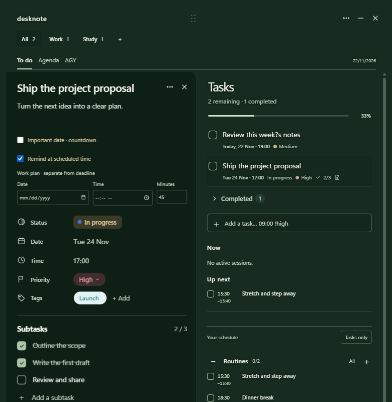
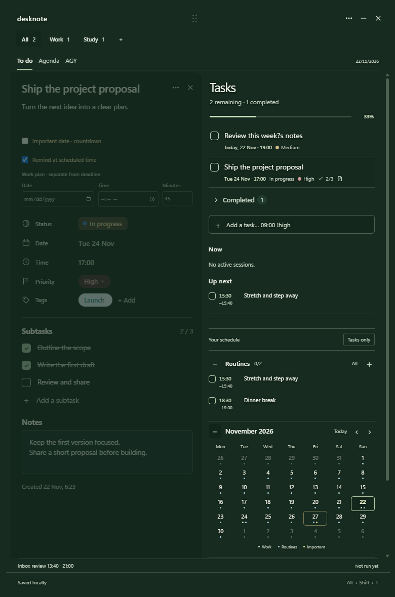

<div align="center">

# Desknote

### Your day, right on your desktop.

A transparent Windows planner for tasks, routines and the time between them.

[](#getting-started) [](#under-the-hood) [](LICENSE)

[Get started](#getting-started) · [Features](#a-place-for-the-whole-day) · [CLI](#a-planner-you-can-script) · [Contribute](#contributing)



<sub>Actual app, sample data. A green backdrop makes the transparent widget readable in this screenshot.</sub>

</div>

---

Your tasks should be easy to find without opening another browser tab. **Desknote lives in the Windows desktop layer**, above your wallpaper and behind application windows. Press **Win+D** and your day is still there.

Keep deadlines, planned work, recurring routines and important dates together. Add reminders when you need them, or connect AGY to help organize work around the schedule you already have.

Built on [Task Nest](https://github.com/GovinduSasanka/task-nest) by [Govindu Sasanka](https://github.com/GovinduSasanka). Desknote extends its task widget with native desktop attachment, scheduling, notifications, a CLI and optional AI integrations.

## A place for the whole day

| Feature | What it does |
| --- | --- |
| **A true desktop widget** | Transparent, behind application windows, visible with Win+D. Drag to move; collapse when you need space. |
| **Tasks with context** | Lists, status, priority, dates, times, tags, subtasks, descriptions and notes. Open details beside the task list. |
| **Deadlines and work plans** | Keep the due date separate from the time you intend to work. A proposed work block never becomes a made-up deadline. |
| **Routines that repeat** | Schedule weekly habits, check off individual days and make dated adjustments without rewriting the weekly routine. |
| **Calendar and countdowns** | Browse a month or a day's agenda. Track birthdays, exams and milestones, including yearly events. |
| **Now and up next** | See active sessions and the next scheduled item, even when other schedule sections are collapsed. |
| **Reminders and alarms** | Scheduled reminders run in the background. A separate wake-up alarm keeps ringing until dismissed. |
| **CLI and optional AGY** | Manage the planner from a terminal, chat with AGY, or review connected inboxes to propose work slots. |

The interface, calendar, notifications and CLI help are in **English**. Your task titles and notes stay in the language you wrote them in.

<details>
<summary><strong>See the calendar and recurring routines</strong></summary>

<p align="center">

</p>

</details>

## Getting started

**Current distribution: run from source.** An installer build command is available below; there is no published Desknote installer linked here.

You need **Windows x64**, **Node.js with npm**, and **Python 3.12** for the desktop attachment helper. No AI account is needed for tasks, calendars, routines or reminders.

```powershell
git clone https://github.com/bGiaHuy/desknote.git
cd desknote
npm install
npm start
```

For native attachment and the Zalo adapter, this version expects the standard per-user Python installation at `%LOCALAPPDATA%\Programs\Python\Python312\python.exe`.

| Action | How |
| --- | --- |
| Add a task | Type in the add box and press Enter |
| Add a time or priority quickly | Try `Review notes 19:00 !high` |
| Open details | Click a task title |
| Add a routine or event | Use **+** beside its schedule section |
| Focus on tasks | Click **Tasks only**; **Show schedule** restores the schedule |
| Move or collapse | Drag the header; use **−** to collapse |
| Show or hide | Press **Alt+Shift+T**, or use the tray icon |
| Restore the position | Tray menu → **Reset position** |
| Change startup and reminders | Open the **⋯** menu or tray menu |

The PC must be awake and the app running for reminders, alarms and automatic reviews. Notification banners and audio also depend on Windows settings and speaker output.

## A planner you can script

The CLI talks to the app so writes are serialized and the widget refreshes immediately.

```powershell
node cli.js list --json
node cli.js add "Prepare the project demo" --list work --priority high
node cli.js routine.add "Take a walk" --time 17:30 --days 1,2,3,4,5
node cli.js event.add "Project demo" --date 2026-12-15 --important true
node cli.js schedule --from 2026-12-01 --to 2026-12-07
node cli.js help
```

Run `npm link` to use `desknote` instead of `node cli.js`.

For tasks, `--date` and `--time` describe a **deadline**. `--plan-date`, `--plan-time` and `--minutes` describe a separate work block. Structured requests and batches are supported through `node cli.js request FILE.json`.

## Optional assistance, connected locally

### AGY chat

The AGY tab uses your separately installed and authenticated **AGY CLI**, its account and its default model. It receives planner context and returns structured changes that the app validates before saving. Replies default to English; you can explicitly request another language.

The current integration looks for `%LOCALAPPDATA%\agy\bin\agy.exe`. Without AGY, the regular planner still works.

### Inbox reviews

Reviews can turn actionable messages into tasks and proposed work slots. They use the local read-only adapters for **Zalo**, **Messenger** and optionally **Gmail**.

- **Zalo:** reads the existing listener's local SQLite cache. Configured thread exclusions are applied before message content is retrieved.
- **Messenger:** reuses an existing `messenger-mcp` listener at `127.0.0.1:8765` and its local token file. Coverage is limited to messages captured by that listener.
- **Gmail:** uses Google's read-only permission and Windows-encrypted local credentials. See [Gmail setup](GMAIL-SETUP.md).

Configure Zalo in `inbox-local.json` inside the app's data directory:

```json
{
  "zaloAccount": "YOUR_ACCOUNT_ID",
  "excludedZaloThreads": ["THREAD_TO_EXCLUDE"]
}
```

Review times, proactive checks and daily routine adjustments are controlled in the review panel. Defaults include 13:40 and 21:00 reviews; proactive checks are limited to six additional AGY attempts per day. Empty inbox checks do not call the model. Disable reviews there if you only want the planner.

**Reviews do not send messages, delete tasks or mark work complete.** Proposed plans preserve fixed schedules; routine adjustments carry reasons and can be undone. Partial or disconnected sources are reported.

AGY requests consume your account quota. Connected review content is supplied to AGY for processing; the optional integrations are not an offline-only feature.

## Your data

Planner data is stored locally in `%APPDATA%\Desknote\`. Existing installations retain their previous data directory; `DESKNOTE_DATA_DIR` overrides it.

| File | Contents |
| --- | --- |
| `tasknest.json` | Tasks, lists, routines, events and completion records |
| `tasknest.json.bak` | Previous version saved before a store write |
| `agy-chat.json` | Local AGY conversation history |
| `notifications-settings.json` / `notifications-state.json` | Reminder preferences and delivery tracking |
| `review-settings.json` / `review-state.json` | Review preferences, cursors and reports |
| `inbox-local.json` | Your local inbox configuration |

Use the CLI or app for edits so concurrent changes are preserved. Personal schedules, local instructions, credentials and integration configuration are excluded from this repository. There is no cross-device or Google Calendar sync.

## Under the hood

Electron with vanilla HTML, CSS and JavaScript; local JSON storage; a Python helper for Explorer desktop attachment. No frontend framework or transpilation step is required to run the app.

| Area | Files |
| --- | --- |
| Desktop window, tray and IPC | `main.js`, `preload.js`, `desktop_host.py` |
| Tasks, validation and persistence | `store.js`, `cli.js`, `src/app.js` |
| Calendar, routines and agenda | `src/schedule-core.js`, `src/schedule-ui.js` |
| Reminders and wake-up alarm | `notification-engine.js`, `reminder-window.js`, `alarm.js` |
| AGY chat | `agy-bridge.js`, `agy-response.schema.json`, `src/agy-ui.js` |
| Reviews and planning | `review-engine.js`, `work-planner.js`, `routine-policy.js` |
| Read-only inbox adapters | `inbox-mcp.js`, `inbox-reader.js`, `gmail-reader.js` |

```powershell
npm test       # isolated data, mocked model and audio integrations
npm run dist   # build a Windows x64 NSIS installer in dist/
```

Native desktop checks require an interactive Windows session. The tests do not send live AGY requests or ring a real alarm. Personal alarm audio is not bundled; Windows alarm audio is the fallback.

## Contributing

Bug reports and focused pull requests are welcome. Include reproduction steps and the Windows/Python versions for desktop attachment issues. Please use sample data in screenshots and keep credentials, messages and personal schedules out of issues and commits.

Interested in bringing a feature back to Task Nest? Open an issue here to discuss a small, independently reviewable change.

[Report an issue](https://github.com/bGiaHuy/desknote/issues) · [Original Task Nest](https://github.com/GovinduSasanka/task-nest)

## Credits and license

Desknote is developed by [Gia Huy](https://github.com/bGiaHuy), building on **Task Nest** by [Govindu Sasanka](https://github.com/GovinduSasanka). The original project history and copyright notice are preserved.

Licensed under [MIT](LICENSE).
